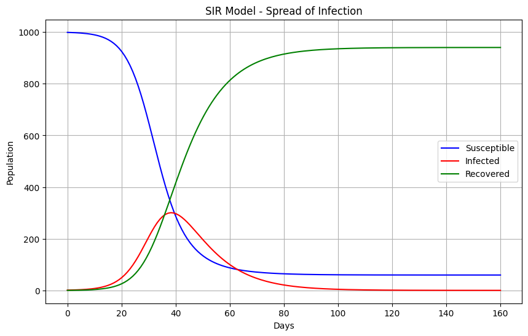
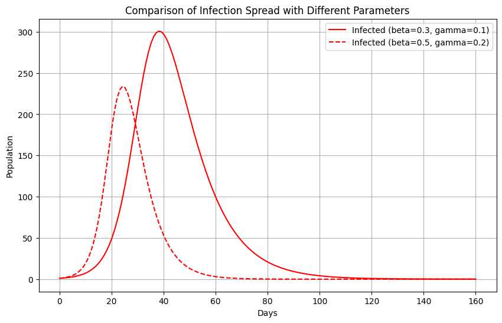

# SIR Epidemic Simulation

A Python simulation of how an infectious disease spreads through a population, built on the classic **SIR compartmental model**. It compares two outbreak scenarios and plots how the number of susceptible, infected and recovered people changes over 160 days.

## The model

The population is split into three groups:

| Compartment | Meaning |
|---|---|
| **S** (Susceptible) | People who can still catch the disease |
| **I** (Infected) | People who currently have it and can spread it |
| **R** (Recovered) | People who have recovered and are no longer infectious |

Movement between groups is described by three differential equations:

```
dS/dt = -β · S · I / N
dI/dt =  β · S · I / N  -  γ · I
dR/dt =  γ · I
```

- **β (beta):** transmission rate, how quickly the disease spreads
- **γ (gamma):** recovery rate, how quickly infected people recover
- **N:** total population (constant)
- **R₀ = β / γ:** the basic reproduction number, the average number of people one infected person infects in a fully susceptible population

The equations are solved numerically with `scipy.integrate.odeint`.

## Scenarios

Both scenarios start with a population of 1,000 people and a single infected person.

| Scenario | β | γ | R₀ |
|---|---|---|---|
| A: baseline | 0.3 | 0.1 | 3.0 |
| B: faster spread, faster recovery | 0.5 | 0.2 | 2.5 |

## Results

| | Scenario A | Scenario B |
|---|---|---|
| Peak infected | ~301 people | ~234 people |
| Day of peak | ~day 38 | ~day 24 |
| Total ever infected | ~94% | ~89% |

**What this shows:** Scenario B spreads faster, so its peak arrives about two weeks earlier. But because people also recover twice as quickly, its R₀ is lower, so the peak is lower and fewer people are infected overall. A higher transmission rate does not always mean a worse outbreak. What matters is the balance between spread and recovery.





## Run it

```bash
pip install numpy scipy matplotlib
python Disease_Simulation.py
```

Two plots are produced: the S/I/R curves for the baseline scenario, and a comparison of the infected curve under both scenarios. Change `beta`, `gamma`, `N` or the time range at the top of `Disease_Simulation.py` to try your own scenarios.

## Tech

Python, NumPy, SciPy (ODE solver), Matplotlib

## Limitations and possible extensions

- Assumes a fixed population with no births, deaths or reinfection, and everyone mixing equally
- Adding an **Exposed** stage (SEIR) would model the incubation period
- Adding **vaccination** or **lockdown** (a time-varying β) would show how interventions flatten the curve
- Fitting β and γ to real outbreak data would test how well the model matches reality